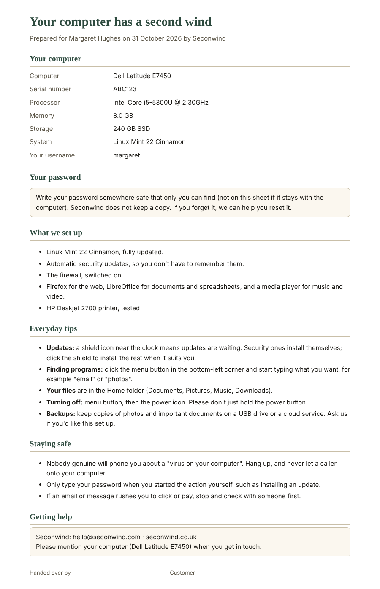

# Seconwind Revival kit

Tools for install day, kept on the Seconwind USB stick next to the Linux Mint installer.

1. **Inventory**: before you install, check the machine. You get the make and model, CPU, RAM, disks (SSD or HDD, size, what's on them, SMART health), battery wear, graphics, Wi-Fi and firmware mode, plus a verdict (**good**, **works with upgrade** or **not suitable**) with reasons. Known awkward Wi-Fi and graphics chips are flagged.
2. **Post-install setup**: after the install, one script updates everything, turns on automatic updates and the firewall, adds a few apps, and lists drivers and firmware to check by hand.
3. **Handover sheet**: a printable page for the customer with their computer's details, what was set up, everyday tips, staying-safe advice and how to get help.

Nothing here writes to the customer's disks, partitions or files. The inventory is read-only. The setup script refuses to run on the live USB, and by default it only shows what it would do.

It needs only Python 3 (already on Linux Mint) and bash, with no installs.

## On install day

Boot the machine from the Mint live USB, open a terminal in the kit folder, and run:

```bash
sudo python3 -m revival inventory --out reports/smith-dell.json --jobbook reports/smith-dell-jobbook.json
```

`sudo` adds the serial number and disk health. Without it, the inventory still works. If `smartctl` is missing on the live session, run `sudo apt install smartmontools` first (that installs into the live session only, not onto the customer's disk).

Read the verdict and notes, then **confirm the customer's files are backed up** before installing.

After installing and rebooting into the new system, copy the kit across or run it from the stick:

```bash
sudo ./scripts/post-install.sh            # dry run: shows the plan
sudo ./scripts/post-install.sh --apply    # does it, logging to /var/log/seconwind-revival.log
```

To change the extra apps, set `EXTRA_PACKAGES="vlc hplip-gui gimp" sudo -E ./scripts/post-install.sh --apply`.

Then make the handover sheet and print it from Firefox:

```bash
python3 -m revival handover --inventory reports/smith-dell.json \
  --customer "Mrs Smith" --username smith --extra "HP Deskjet 2700 printer, tested" \
  --out reports/smith-handover.html
```



## Into the job book

The `--jobbook` file has the fields of a job book **Machine** record (make and model, serial, CPU, RAM, disk, disk health, what it came with, verdict notes). Import it with:

```bash
cd ~/seconwind-jobbook
python3 -m jobbook import-machine /path/to/smith-dell-jobbook.json --client "Mrs Smith"
```

## Tests

```bash
python3 -m unittest discover -s tests
```

Parsers are tested against saved sample output, so the tests run on any machine.
